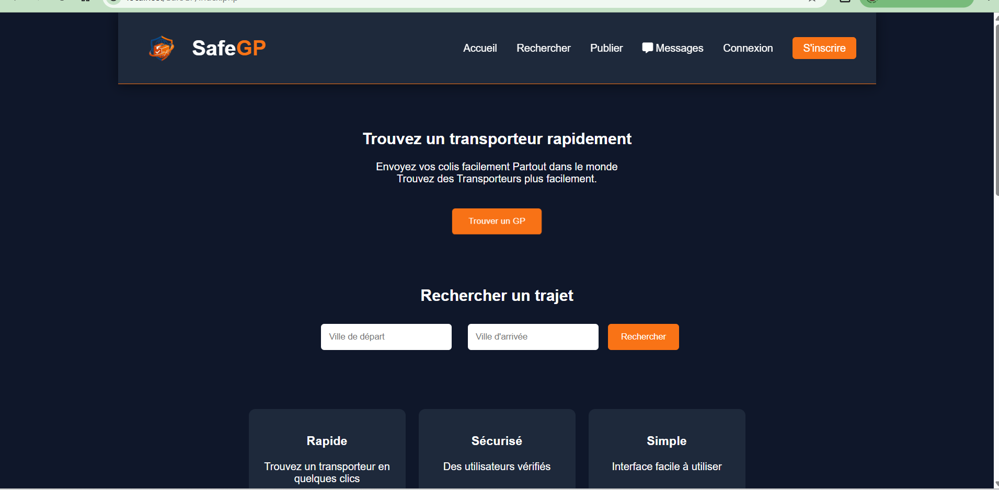
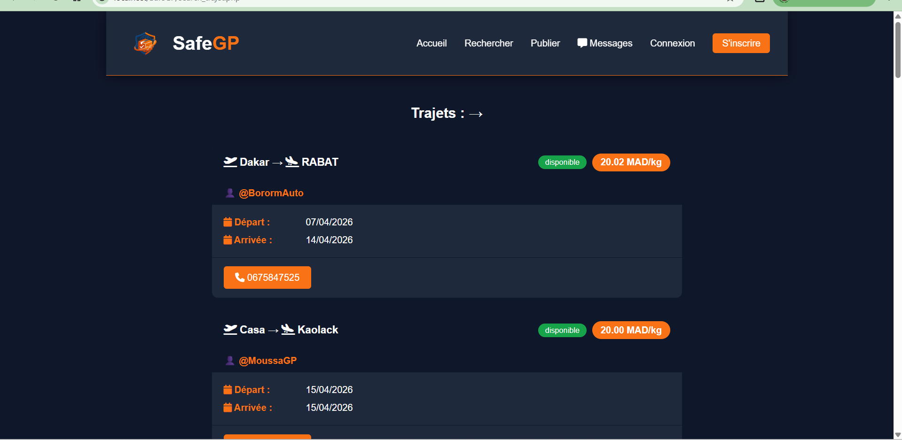
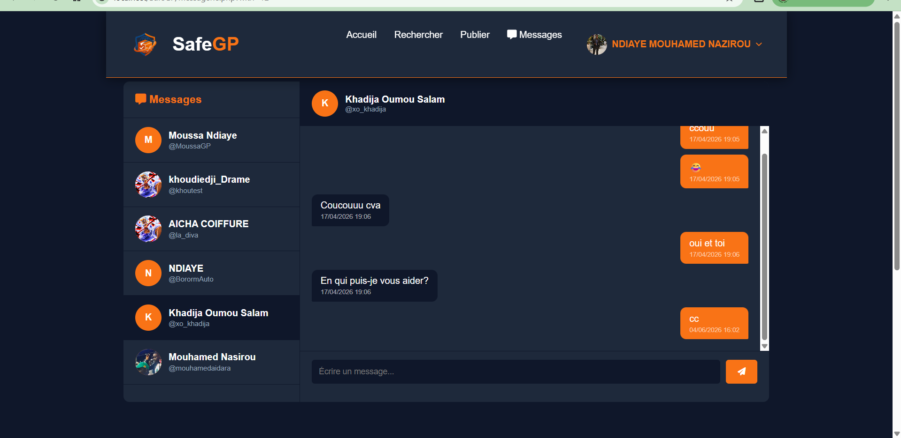
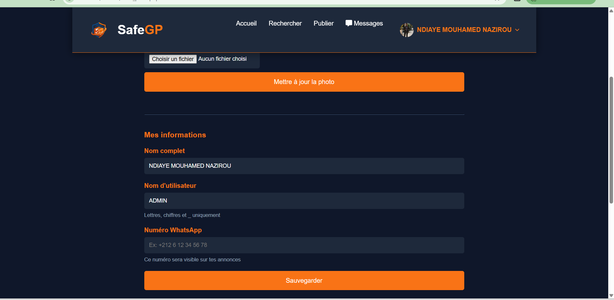

# SafeGP

Plateforme web de mise en relation entre **GP** (voyageurs/transporteurs) et **expéditeurs de colis** sur les trajets Maroc ↔ Sénégal.

🔗 **Démo en ligne** : [safegp.free.nf](http://safegp.free.nf)

##  Principe

- Un **GP** publie un trajet (ville de départ, ville d'arrivée, dates, prix au kilo, contact)
- Un **expéditeur** recherche un trajet disponible par ville de départ / arrivée
- Les deux parties échangent via une messagerie intégrée pour finaliser l'envoi

##  Fonctionnalités

- Inscription / connexion des utilisateurs
- Profils utilisateurs avec photo
- Publication et recherche de trajets
- Gestion des trajets (modification, suppression, changement de statut) depuis un tableau de bord personnel
- Messagerie interne entre utilisateurs
- Back-office admin avec gestion des rôles (vérification côté serveur)
- Disponibilités : kilos restants, date limite de dépôt, heures de départ/arrivée, horaires de dépôt et de réception, GP disponible ou non, horaires où il est joignable
- Plusieurs numéros WhatsApp par profil, chacun avec le nom de son propriétaire, et trajets publiés pour un autre voyageur avec ses propres numéros
- Recherche de membres par nom ou @nom d'utilisateur
- Formule gratuite limitée à 5 publications par mois, comptes premium illimités (activés depuis l'admin)
- Retours clients (suggestions, problèmes) consultables dans le panel admin
- Aperçu avec logo quand on partage un lien (WhatsApp, Facebook...)

##  Aperçu

### Page d'accueil


### Transporteurs disponibles


### Recherche de trajets


### Connexion


### Publication d'un trajet


### Messagerie



### Profil utilisateur



##  Stack technique

- **Backend** : PHP (mysqli, requêtes préparées)
- **Base de données** : MySQL
- **Frontend** : HTML, CSS, JavaScript

##  Installation locale (Optionnel bien sûr)

1. Cloner le dépôt
   ```bash
   git clone https://github.com/MouhamedNazir/SafeGP.git
   ```
2. Créer une base de données MySQL nommée `safegp` puis y importer `schema.sql`
   - Base déjà existante : appliquer à la place les fichiers de `migrations/` dans l'ordre
3. Copier `config.example.php` en `config.php` et renseigner vos identifiants de connexion à la base
4. Lancer le projet sur un serveur local (ex. XAMPP/WAMP) et ouvrir `index.php`

##  Statut

Projet personnel en cours de développement — de nouvelles fonctionnalités sont à venir.

##  Auteur

Mouhamed Nazirou Ndiaye — [LinkedIn](https://www.linkedin.com/in/mouhamed-nazirou-ndiaye) · [GitHub](https://github.com/MouhamedNazir)
