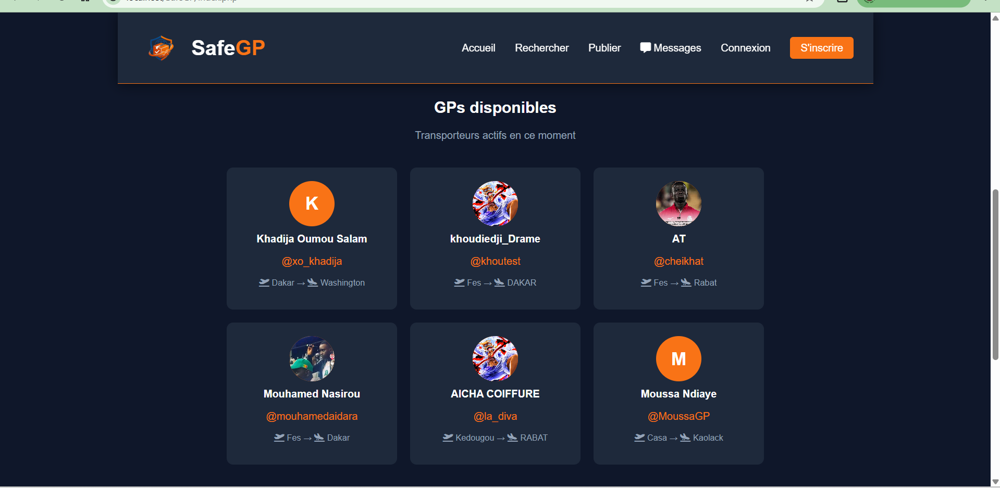
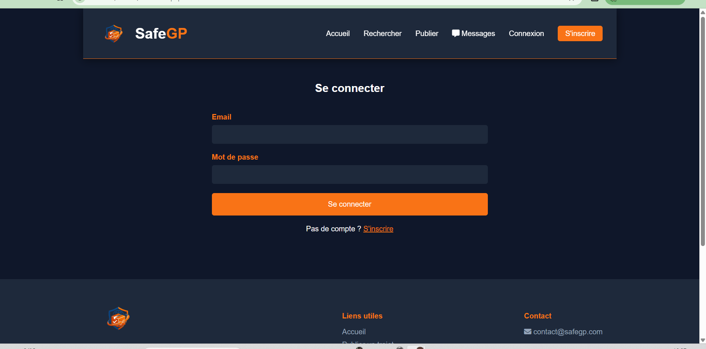

# SafeGP

Plateforme web de mise en relation entre **GP** (voyageurs/transporteurs) et **expéditeurs de colis** partout dans le monde (né sur l'axe Maroc ↔ Sénégal).

🔗 **Démo en ligne** : [safegp.free.nf](http://safegp.free.nf)

##  Principe

- Un **GP** publie un trajet (ville de départ, ville d'arrivée, dates, prix au kilo, contact)
- Un **expéditeur** recherche un trajet disponible par ville de départ / arrivée
- Les deux parties échangent via une messagerie intégrée pour finaliser l'envoi

##  Fonctionnalités

- Inscription / connexion des utilisateurs
- Profils utilisateurs avec photo
- Publication et recherche de trajets
- Gestion des trajets (modification, suppression, changement de statut) depuis un tableau de bord personnel
- Messagerie interne entre utilisateurs
- Back-office admin avec gestion des rôles (vérification côté serveur)
- Disponibilités : kilos restants, date limite de dépôt, heures de départ/arrivée, horaires de dépôt et de réception, GP disponible ou non, horaires où il est joignable
- Plusieurs numéros WhatsApp par profil, chacun avec le nom de son propriétaire, et trajets publiés pour un autre voyageur avec ses propres numéros
- Recherche de membres par nom ou @nom d'utilisateur
- Formules : Gratuit (4 trajets/mois), Standard (8 trajets, 500 FCFA/mois ou 5 000 FCFA/an), Illimité (750 FCFA/mois ou 7 500 FCFA/an), avec équivalents en €, $ et DH
- Paiement par Wave / Orange Money : le membre saisit la référence, l'admin vérifie et valide ; rappel avant expiration, retour automatique en Gratuit
- Retours clients (suggestions, problèmes) consultables dans le panel admin
- Aperçu avec logo quand on partage un lien (WhatsApp, Facebook...)
- Confirmation de l'adresse e-mail, mot de passe oublié, changement de mot de passe et d'e-mail, suppression de son compte
- Notifications : badge des messages non lus, e-mail à la réception d'un message, e-mail aux admins pour chaque retour client
- Prix au kilo en dirham, euro, dollar ou franc CFA
- Ouvert au monde entier : pays de départ et d'arrivée avec drapeaux, 8 devises (DH, €, $, FCFA, £, $ CA, CHF)
- Recherche par pays, ville et période (cette semaine, ce mois-ci, entre deux dates)
- Messagerie en direct : messages sans rechargement, « Vu », séparateurs de jours, recherche de conversations, bouton « Contacter pour ce trajet »
- Thème clair et sombre (bouton ☀/☾, suit le réglage de l'appareil)
- Site adapté au mobile (menu ☰, messagerie, tableaux admin)
- Sécurité : mots de passe bcrypt, requêtes préparées, jetons CSRF, cookies de session sécurisés, HTTPS forcé (optionnel), erreurs masquées en ligne, blocage après 5 essais de connexion, en-têtes de sécurité, aucun script exécutable dans uploads/
- Conditions d'utilisation, signalement d'annonces
- Avis et notes des GP (seulement après un échange de messages), badge « GP vérifié » (pièce d'identité contrôlée puis supprimée)
- Page dédiée à chaque annonce avec partage WhatsApp / Facebook et aperçu soigné du lien
- Alertes de trajets par e-mail (« préviens-moi quand un trajet France → Sénégal est publié »)
- Site en français et en anglais (bouton FR / EN, e-mails dans la langue du membre)
- Paiement des abonnements par Wave, Orange Money ou virement bancaire
- Photos compressées automatiquement, trajets terminés passés en « arrivé », page 404, recherche et pagination dans l'admin

##  Aperçu

### Page d'accueil


### Transporteurs disponibles


### Recherche de trajets


### Connexion


### Publication d'un trajet


### Messagerie


### Profil utilisateur


##  Stack technique

- **Backend** : PHP (mysqli, requêtes préparées)
- **Base de données** : MySQL
- **Frontend** : HTML, CSS, JavaScript

##  Installation locale (Optionnel bien sûr)

1. Cloner le dépôt
   ```bash
   git clone https://github.com/MouhamedNazir/SafeGP.git
   ```
2. Créer une base de données MySQL nommée `safegp` puis y importer `schema.sql`
   - Base déjà existante : appliquer à la place les fichiers de `migrations/` dans l'ordre (001 à 005)
3. Copier `config.example.php` en `config.php` et renseigner vos identifiants de connexion à la base
   (et, pour les e-mails, un serveur SMTP : voir les commentaires du fichier)
4. Lancer le projet sur un serveur local (ex. XAMPP/WAMP) et ouvrir `index.php`

##  Statut

Projet personnel en cours de développement — de nouvelles fonctionnalités sont à venir.

##  Auteur

Mouhamed Nazirou Ndiaye — [LinkedIn](https://www.linkedin.com/in/mouhamed-nazirou-ndiaye) · [GitHub](https://github.com/MouhamedNazir)
