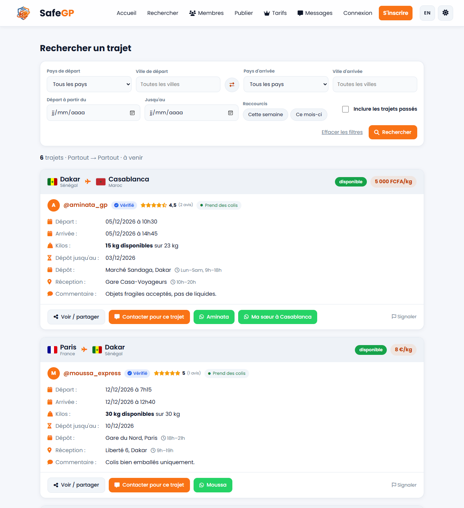
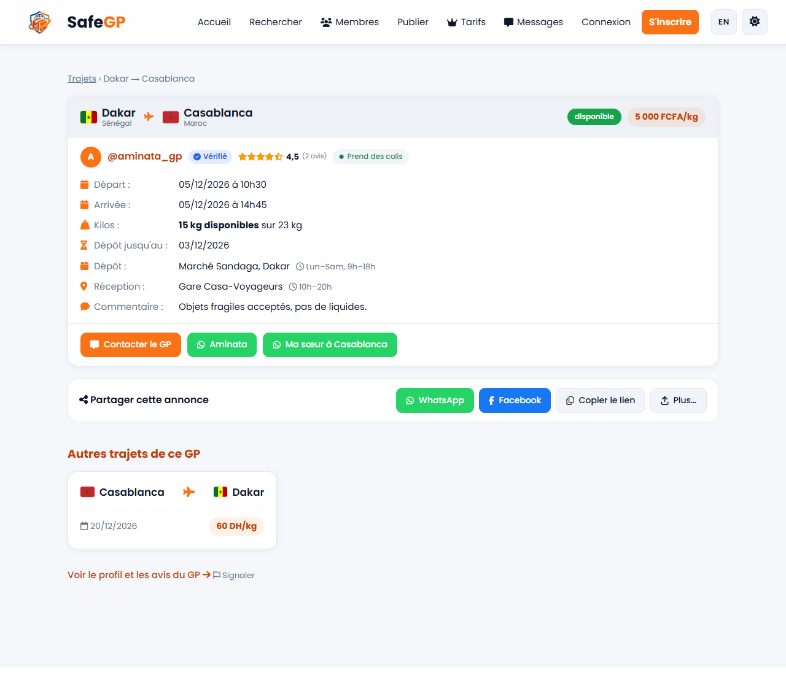
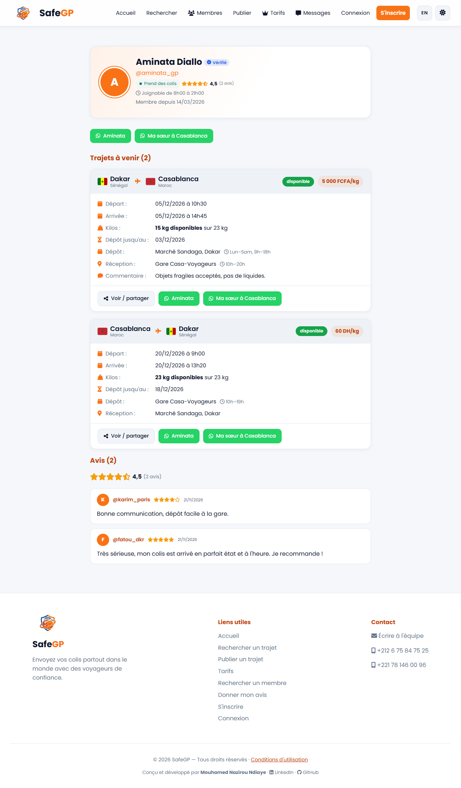
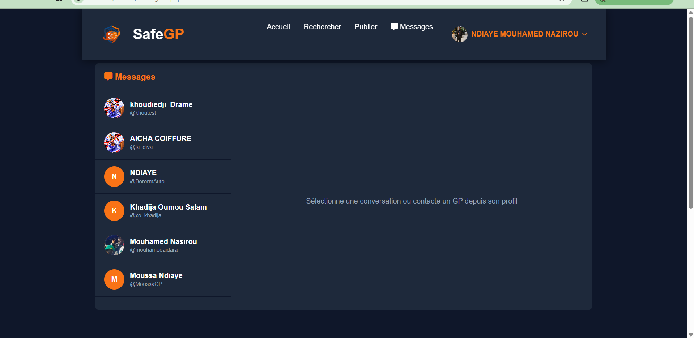
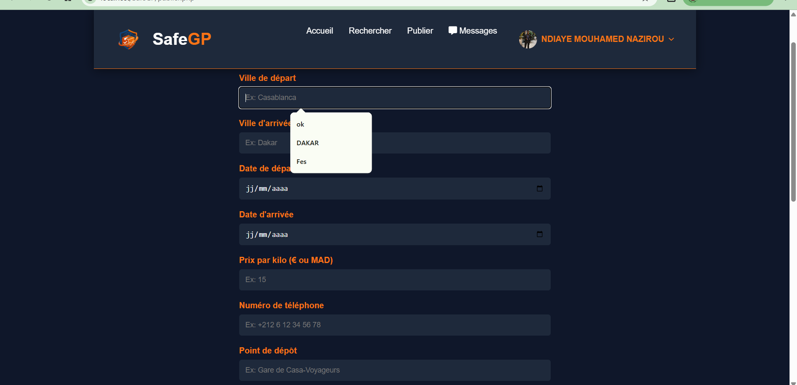
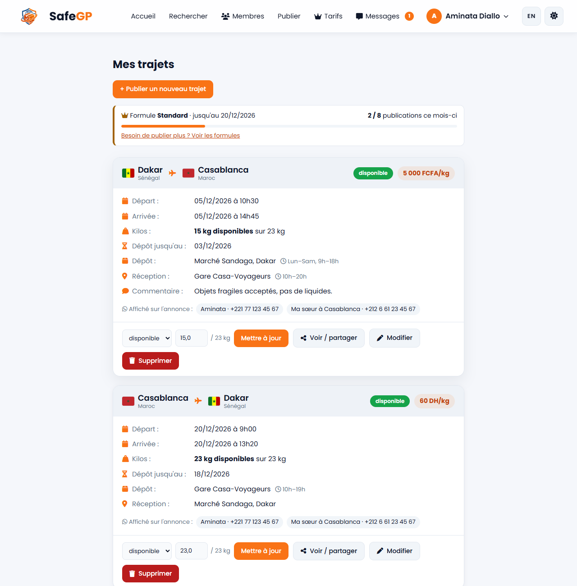
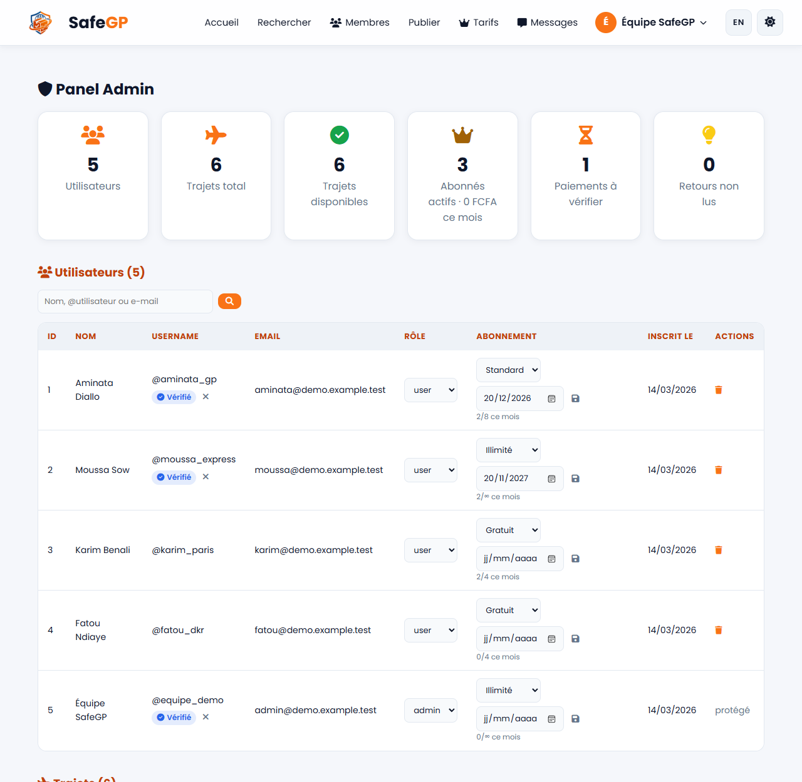
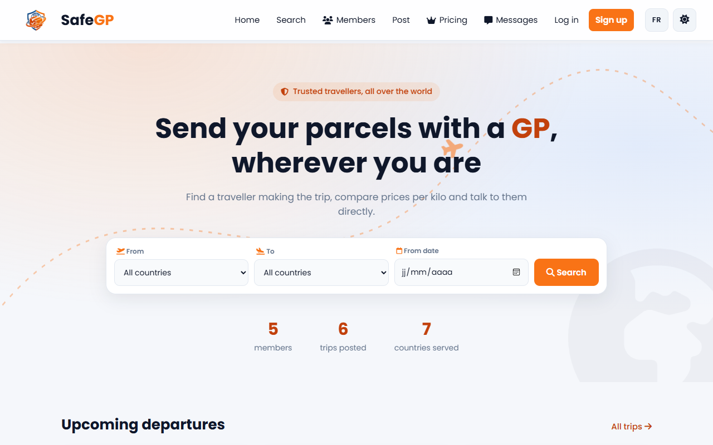

# SafeGP

Plateforme web de mise en relation entre **GP** (voyageurs qui ont de la place dans leurs bagages) et **expéditeurs de colis**, partout dans le monde. Né sur l'axe Maroc ↔ Sénégal, le site gère aujourd'hui tous les pays, 8 devises, et existe en français et en anglais.

🔗 **Démo en ligne** : [safegp.free.nf](http://safegp.free.nf)


## Principe

1. Un **GP** publie son trajet : pays et villes, dates et heures, prix au kilo, kilos disponibles, points de dépôt et de réception.
2. Un **expéditeur** cherche un trajet par pays, ville et période, compare les prix et consulte les avis du GP.
3. Ils échangent par la **messagerie** du site ou sur **WhatsApp** pour finaliser l'envoi.

## Fonctionnalités

### Trajets et recherche
- Pays de départ et d'arrivée avec drapeaux, plus de 200 pays, 8 devises (DH, €, $, FCFA, £, $ CA, CHF)
- Heures de départ et d'arrivée, capacité et **kilos restants**, date limite de dépôt, horaires de dépôt et de réception
- Trajet publié pour un autre voyageur, avec ses propres numéros WhatsApp
- **Recherche** par pays, ville et période (« Cette semaine », « Ce mois-ci », entre deux dates)
- **Page dédiée à chaque annonce**, avec partage WhatsApp / Facebook et aperçu soigné du lien
- **Alertes par e-mail** : « préviens-moi quand un trajet France → Sénégal est publié »
- Les trajets terminés passent automatiquement au statut « arrivé »

### Envois de colis
- L'expéditeur **réserve des kilos** sur un trajet (poids, contenu, destinataire), avec le prix estimé
- Le GP accepte ou refuse ; les kilos restants du trajet se mettent à jour tout seuls
- Étapes : déposé → en route → arrivé → remis, avec **photo de preuve** au dépôt et à la remise
- **Code de suivi** (`SGP7K3M9X`) : le destinataire suit le colis sans compte, sans voir ni contenu ni téléphones
- **Reçu de dépôt** imprimable entre le GP et l'expéditeur
- E-mail à chaque étape, page « Mes envois » pour les deux parties

### Confiance
- **Avis et notes** des GP (1 à 5 étoiles), possibles seulement après un vrai échange de messages
- **Badge « GP vérifié »** : pièce d'identité contrôlée par l'équipe, puis supprimée
- Plusieurs numéros WhatsApp par profil, chacun avec le nom de son propriétaire
- GP disponible ou non, horaires où il est joignable
- Signalement d'annonces, conditions d'utilisation

### Messagerie
- Messages **en direct** (sans recharger la page), Entrée pour envoyer
- Indicateur « Vu », séparateurs de jours, aperçu du dernier message, recherche de conversations
- Bouton « Contacter pour ce trajet » : la conversation affiche la fiche du trajet
- Notifications : badge des messages non lus et e-mail au premier message non lu

### Abonnements
- **Gratuit** : 4 trajets par mois. **Standard** : 8 trajets, 500 FCFA/mois ou 5 000 FCFA/an. **Illimité** : 750 FCFA/mois ou 7 500 FCFA/an (2 mois offerts en annuel)
- Prix en FCFA avec équivalents en €, $ et DH
- Paiement par **Wave**, **Orange Money** ou **virement bancaire** : le membre saisit la référence, l'admin vérifie et valide
- **Capture du reçu de paiement** jointe à la demande (dossier privé, visible par l'admin seulement)
- **Reçu** numéroté (`SGP-2026-0001`) imprimable pour chaque paiement
- **Annulation sous 48 h** si aucun trajet n'a été publié : retour à la formule précédente, remboursement suivi dans l'admin
- Rappel par e-mail 3 jours avant la fin, puis retour automatique à la formule Gratuite

### Comptes
- Inscription avec **confirmation de l'adresse e-mail**, mot de passe oublié
- **Mots de passe robustes** (lettre + chiffre, pas de mot de passe courant ni de nom) avec jauge de solidité
- **E-mails vérifiés** : domaine qui reçoit vraiment des e-mails, adresses jetables refusées, fautes de frappe signalées (« gmial.com »)
- Comptes jamais confirmés supprimés après 7 jours
- Changement de mot de passe et d'e-mail, suppression de son compte
- Photo de profil compressée automatiquement

### Administration
- Statistiques, recherche et pagination des membres et des trajets
- Validation des paiements, des pièces d'identité, gestion des formules et des rôles
- Retours clients (suggestions, problèmes) avec notification par e-mail

### Interface
- **Thème clair et sombre** (bouton ☀/☾, suit le réglage de l'appareil)
- **Français / anglais** (bouton FR / EN, e-mails dans la langue du membre)
- Adapté au mobile : menu ☰, messagerie en une colonne, tableaux défilants

### Sécurité
- Mots de passe hachés (bcrypt), requêtes préparées, jetons CSRF sur tous les formulaires
- Cookies de session sécurisés, HTTPS forcé (optionnel), en-têtes de sécurité
- Blocage temporaire après 5 essais de connexion ratés
- Erreurs masquées en ligne (page « Oups » et journal privé)
- Aucun script exécutable dans `uploads/`, dossiers privés fermés au web

## Aperçu

> Captures réalisées avec des comptes et des trajets de démonstration.

### Recherche de trajets


### Page d'une annonce


### Profil d'un GP, avec avis et badge vérifié


### Messagerie en direct


### Publication d'un trajet


### Tableau de bord du GP


### Formules d'abonnement


### Panel d'administration


### Thème sombre


### Version anglaise


### Sur mobile


## Stack technique

- **Backend** : PHP 8.1+ sans framework (mysqli, requêtes préparées)
- **Base de données** : MySQL / MariaDB
- **Frontend** : HTML, CSS (variables pour les thèmes), JavaScript sans bibliothèque
- **Bibliothèques externes (CDN)** : police Poppins, Font Awesome, flag-icons
- **Extensions PHP** : `mysqli`, `mbstring`, `fileinfo`, `gd` (compression des photos, facultative)
- **E-mails** : client SMTP intégré, compatible Gmail, Brevo… (pas de bibliothèque à installer)

## Installation locale

1. Cloner le dépôt
   ```bash
   git clone https://github.com/MouhamedNazir/SafeGP.git
   ```
2. Créer une base MySQL `safegp` (utf8mb4) et y importer `schema.sql`.
   - **Base déjà existante** : appliquer à la place les fichiers de `migrations/` dans l'ordre (001 à 007), une seule fois chacun.
3. Copier `config.example.php` en `config.php` et renseigner les identifiants de la base.
4. Lancer le projet sur un serveur local (XAMPP, WAMP…) et ouvrir `index.php`.
5. Pour devenir administrateur après inscription :
   ```sql
   UPDATE users SET role = 'admin' WHERE email = 'ton@email.com';
   ```

En local, sans SMTP configuré, les e-mails ne partent pas : ils sont enregistrés dans `logs/emails/` pour pouvoir cliquer sur les liens.

## Configuration (`config.php`)

| Réglage | Rôle |
|---|---|
| `SMTP_*`, `EMAIL_*` | Envoi des e-mails (confirmation, mot de passe oublié, notifications). Avec Gmail : un « mot de passe d'application ». |
| `SITE_URL` | Adresse publique du site, utilisée dans les liens des e-mails. |
| `FORCER_HTTPS` | `true` une fois le certificat SSL installé : tout passe en `https://`. |
| `PAIEMENT_WAVE`, `PAIEMENT_ORANGE_MONEY`, `PAIEMENT_TITULAIRE` | Numéros affichés pour payer les abonnements. |
| `BANQUE_*` | Coordonnées pour le paiement par virement (vide = option masquée). |
| `CONTACT_TELEPHONES` | Numéros affichés dans le pied de page. |
| `MODE_DEBUG` | `true` seulement pour déboguer en ligne (affiche les erreurs PHP). |

`config.php` n'est jamais envoyé sur GitHub (voir `.gitignore`).

## Organisation du code

| Fichier / dossier | Contenu |
|---|---|
| `init.php` | Chargé en haut de chaque page : erreurs, config, langue, session, CSRF, fonctions |
| `fonctions.php` | Fonctions communes : trajets, WhatsApp, abonnements, avis, alertes, images… |
| `email.php` | Client SMTP, modèles d'e-mails, liens à usage unique |
| `langue.php`, `lang/` | Version anglaise : dictionnaire `lang/en.php` et noms des pays |
| `migrations/` | Évolutions de la base, à appliquer dans l'ordre sur une base existante |
| `schema.sql` | Structure complète, pour une nouvelle installation |

**Ajouter un texte au site** : l'écrire en français dans la page, puis ajouter sa traduction dans `lang/en.php`. Sinon il restera en français sur la version anglaise.

## Statut

Projet personnel en cours de développement.

## Auteur

Mouhamed Nazirou Ndiaye — [LinkedIn](https://www.linkedin.com/in/mouhamed-nazirou-ndiaye) · [GitHub](https://github.com/MouhamedNazir)
